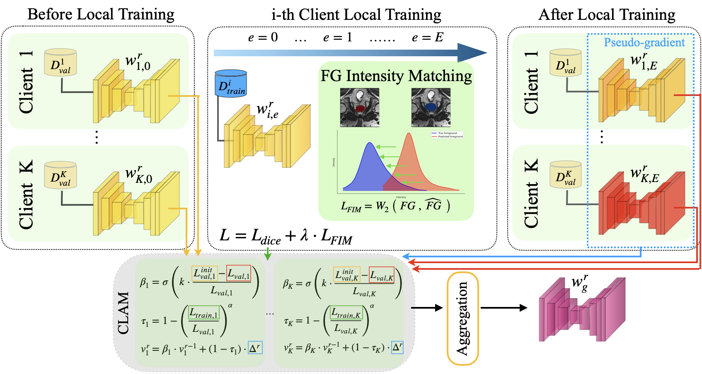

# FedCLAM: Client Adaptive Momentum with Foreground Intensity Matching for Federated Medical Image Segmentation
This is the PyTorch implemention of our paper **FedCLAM: Client Adaptive Momentum with
Foreground Intensity Matching for Federated
Medical Image Segmentation** accepted in MICCAI 2025 by Vasilis Siomos, Jonathan Passerat-Palmbach, and Giacomo Tarroni
## Abstract
> Federated learning is a decentralized training approach that keeps data under stakeholder control while achieving superior performance over isolated training. While inter-institutional feature discrepancies pose a challenge in all federated settings, medical imaging is particularly affected due to diverse imaging devices and population variances, which can diminish the global model's effectiveness. Existing aggregation methods generally fail to adapt across varied circumstances. To address this, we propose FedCLAM, which integrates \textit{client-adaptive momentum} terms derived from each client's loss reduction during local training, as well as a \textit{personalized dampening factor} to curb overfitting. We further introduce a novel \textit{intensity alignment} loss that matches predicted and ground-truth foreground distributions to handle heterogeneous image intensity profiles across institutions and devices. Extensive evaluations on two datasets show that FedCLAM surpasses eight cutting-edge methods in medical segmentation tasks, underscoring its efficacy.


## Usage
TBD


## Citation
If you find the code and paper useful, please cite our paper.
```latex
TBD
```
